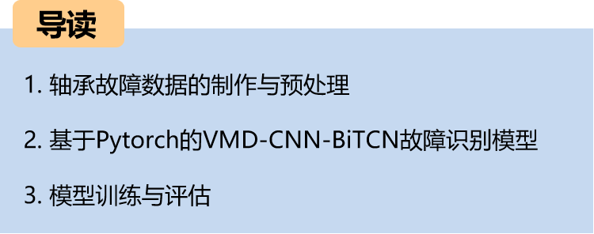
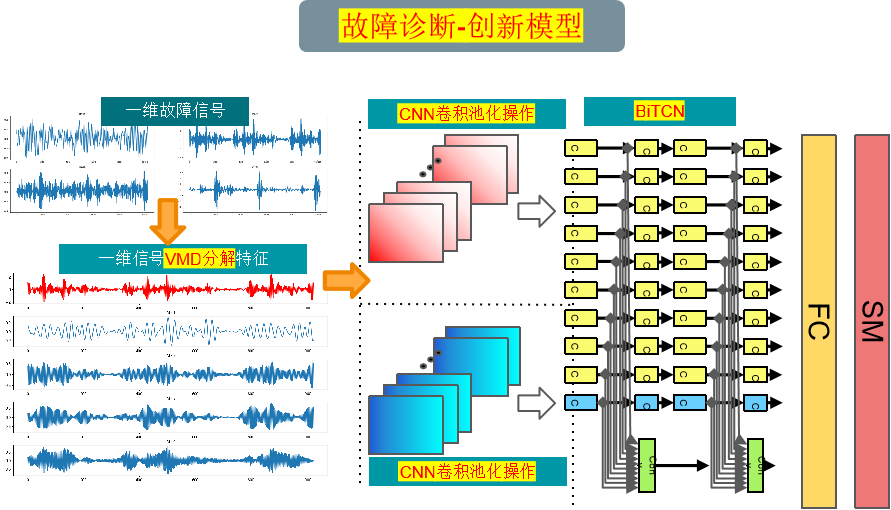
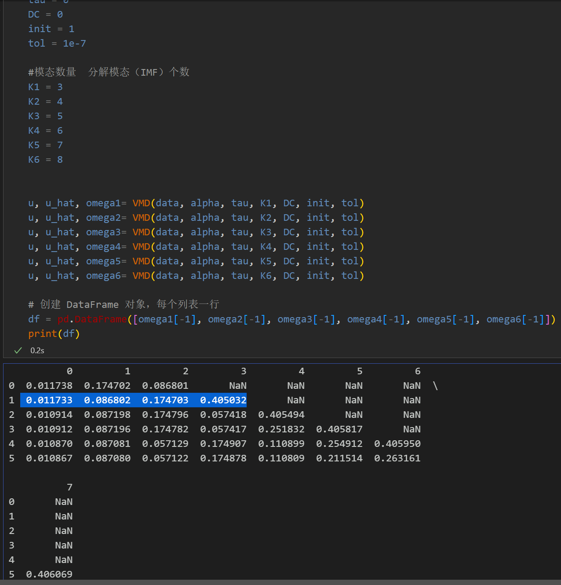
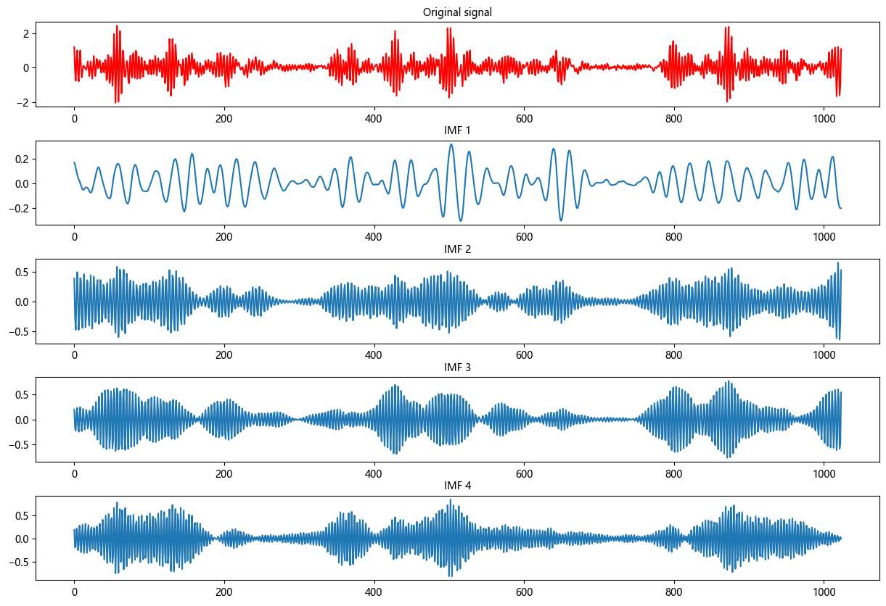
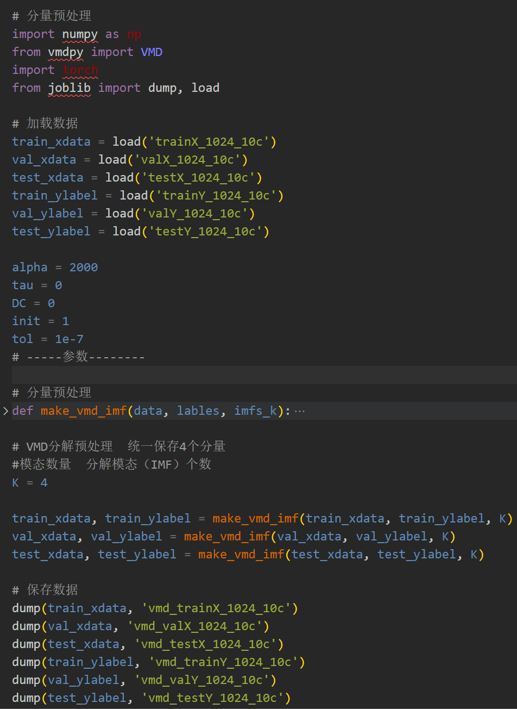
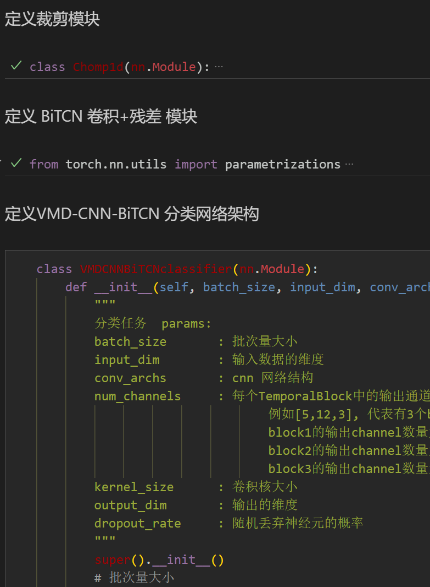
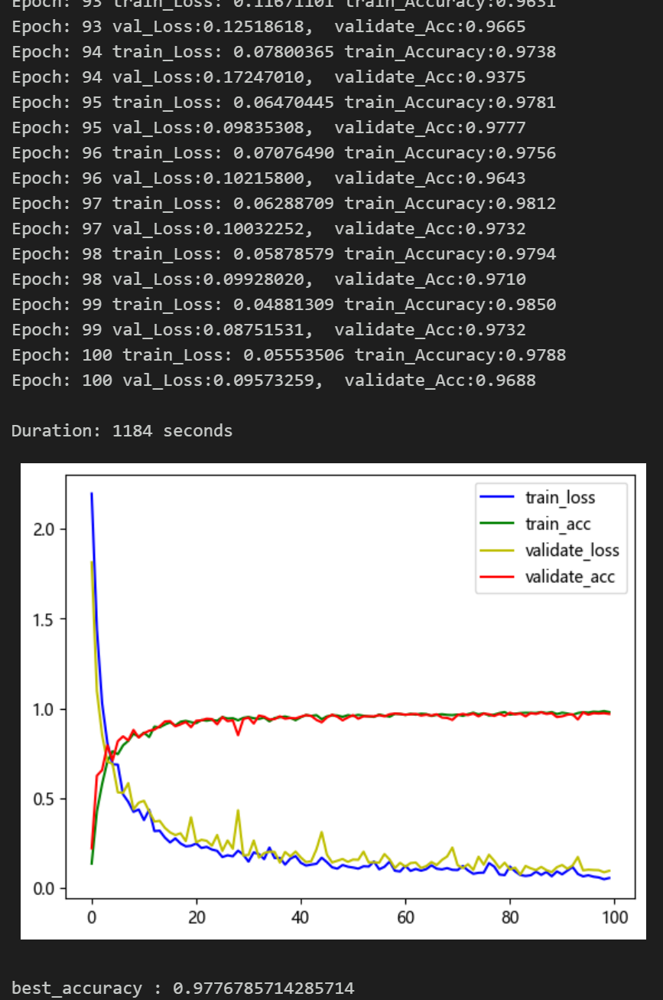
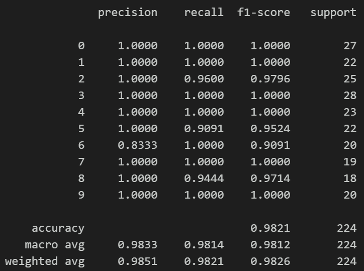
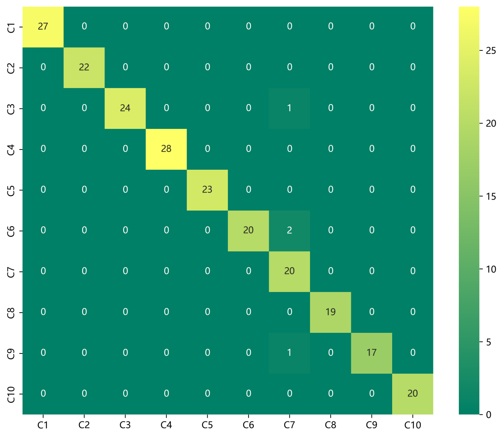
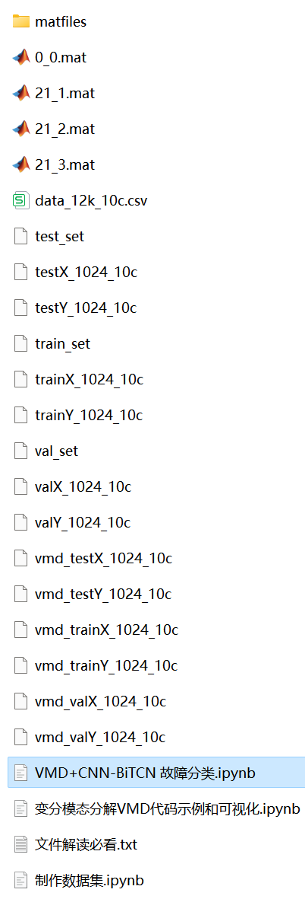

# Python Bearing Fault Diagnosis (21) Innovative Diagnosis Model Based on VMD-CNN-BiTCN

Including the complete CWRU bearing fault dataset, as well as the fault signal dataset, classification data, and label set that have been generated and ready for use.
50 epochs, with an accuracy of 98%, the VMD-CNN-BiTCN network significantly improves classification results. The model can fully extract spatial and temporal features as well as frequency domain features from bearing fault signals, achieving fast convergence and superior performance with high precision. Innovation is also present!!!
Includes code for data preprocessing and the VMD-CNN-BiTCN classification code.
Environment: Python 3.9, PyTorch 1.8 and above.
\tInnovative Model for Bearing Fault Diagnosis Based on VMD-CNN-BiTCN:
\t1. Innovation Points:
1. Utilize VMD to decompose the raw signal into multiple modal components, extracting its frequency and time domain features;
\t  
2. Principle and Process:
Firstly, the original bearing signal is decomposed using VMD to obtain multiple modal components; each modal component serves as input for CNN for feature extraction and abstraction; the features extracted by CNN are then processed through BiTCN for time series modeling and feature fusion; finally, the fused features are utilized for bearing fault diagnosis and classification. By integrating these two models, the innovative model can achieve better performance and results in bearing fault diagnosis tasks, enhancing the accuracy and efficiency of fault diagnosis.
Preface
This article is based on the bearing data from Case Western Reserve University (CWRU), which first undergoes data preprocessing to create and load the dataset, and finally implements the VMD-CNN-BiTCN model for classifying faulty data through Pytorch. For a detailed introduction to the bearing data from CWRU, please refer to the following text:
Python-Case Western Reserve University (CWRU) Bearing Data Interpretation and Classification Process
1. Bearing Data Loading and Preprocessing
1.1 Import data
Refer to the previous article for preprocessing of fault classification 10, and the Case Western Reserve University bearing data set: Classification 10 dataset.
\ttrain_set, val_set, test_set are all divided into training set, validation set and test set according to the ratio of 7:2:1, and finally save the data.
The above figure is the form of data reading and preprocessing ideas.
1.2 Failure VMD Decomposition and Visualization
Step 1: Mode selection
Observe the center frequency under different K values, select the K value; Starting from K=4, there are modes with similar center frequencies, indicating overdecomposition. Therefore, the number of modes K is set to 4.
\t  
Step 2: Visualization of Decomposition and Breakdown of Faulted VMD
\t  
\t  
1.3 VMD decomposition and preprocessing of fault data
\t  
2. Innovation Diagnosis Model Based on Pytorch's VMD-CNN-BiTCN
2.1 Define the VMD-CNN-BiTCN classification network model
2.2 Set parameters and train the model
100 epochs, accuracy of 98%, VMD-CNN-BiTCN network classification effect is significant. The CNN-BiTCN model can fully extract multi-scale features of bearing fault signals, converges quickly, and has particularly excellent performance, with obvious effects.
\tNote: Adjust parameters.
\tIt is appropriate to increase the number of CNN layers and the dimensionality per layer, and fine-tune the learning rate.
Adjust the number of BiTCN layers and the number of channels per layer, increasing more epochs (note to prevent overfitting)
Change the shape of one-dimensional signal stacking (set appropriate length and dimension)
2.3 Model evaluation
Accuracy, Precision, Recall, F1 Score
Fault classification confusion matrix:
Previously excellent content:
Python-Case Western Reserve University (CWRU) bearing data interpretation and classification processing
Python bearing fault diagnosis (I) Short-time Fourier Transform STFT
Python bearing fault diagnosis (II) Continuous Wavelet Transform CWT
Python bearing fault diagnosis (III) Empirical Mode Decomposition EMD
Pytorch-LSTM bearing fault one-dimensional signal classification (I)
Pytorch-CNN bearing fault one-dimensional signal classification (II)
Pytorch-Transformer bearing fault one-dimensional signal classification (III)
Python bearing fault diagnosis (IV) Based on EMD-CNN fault classification
Python bearing fault diagnosis (V) Based on EMD-LSTM fault classification
Python bearing fault diagnosis (VI) Based on EMD-Transformer fault classification
Python bearing fault diagnosis (VII) Based on EMD-CNN-LSTM fault classification
Python bearing fault diagnosis (VIII) Based on EMD-CNN-GRU parallel model fault classification
Based on FFT + CNN - BiGRU-Attention time-domain, frequency-domain feature attention fusion bearing fault recognition model
Based on FFT + CNN - Transformer time-domain, frequency-domain feature fusion bearing fault recognition model
Python bearing fault diagnosis (IX) Based on VMD+CNN-BiLSTM fault classification
Python Bearing Fault Diagnosis (10) - Fault Classification Based on VMD+CNN-Transformer
Python Bearing Fault Diagnosis (11) - Fault Classification Based on VMD+CNN-BiGRU-Attenion
Cross Attention Fusion of Time and Frequency Features with FFT + CNN-BiLSTM-CrossAttention Bearing Fault Identification Model
Cross Attention Fusion of Time and Frequency Features with FFT + CNN-Transformer-CrossAttention Bearing Fault Identification Model
Introduction to Python Bearing Fault Diagnosis
Python Bearing Fault Diagnosis (13) - Superstrong Machine Learning Recognition Model Based on Fault Signal Feature Extraction
Python Bearing Fault Diagnosis (14) - Highly Innovative Fault Recognition Model
Python Bearing Fault Diagnosis (15) - One-Dimensional Fault Signal Recognition Model Based on CNN-Transformer
Python Bearing Fault Diagnosis (16) - Highly Innovative Fault Recognition Model (II)
SCI 1st Area Highly Innovative Bearing Fault Diagnosis Model!
Python Bearing Fault Diagnosis (18) - Innovative Diagnosis Model Based on CNN-TCN-Attention
Highly Innovative Bearing Fault Diagnosis Model Based on GADF+Swin-CNN-GAM
Attention Magic Modification | Superstrong Bearing Fault Diagnosis Model!
End
\t2. Friends who like this can click the follow button, give the article a "like", share it in WeChat groups or discuss in groups.

## Images

<!-- PAYMENT_BLOCK -->

## Get this dataset

- Payment link (Stripe): [Buy now](https://buy.stripe.com/3cs8yP7sY87d0vu9AB)
- Payment QR code: 

<!-- /PAYMENT_BLOCK -->
